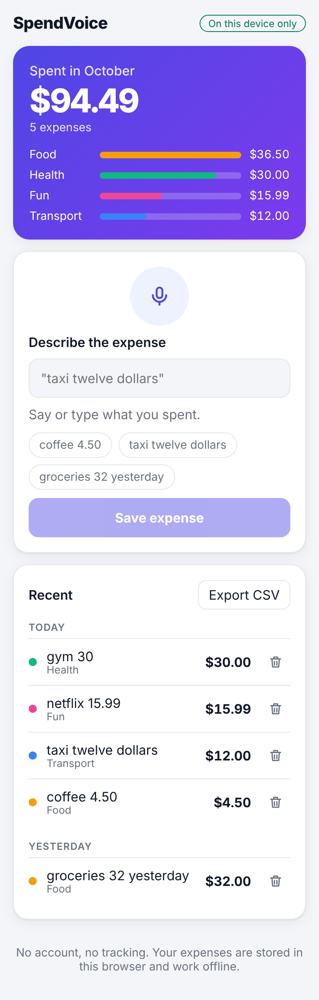

# SpendVoice

[](https://github.com/Ramvilla1997/spendvoice/actions/workflows/ci.yml)

Track expenses by speaking or typing. "Taxi twelve dollars" becomes a saved expense after you check the preview and press Save.

**Live app:** https://ramvilla1997.github.io/spendvoice/



- **Voice or text.** Speak where the browser supports it, or type. Nothing is saved until you confirm.
- **Private by default.** Expenses are stored in your browser's IndexedDB. There are no accounts, no analytics, and no server.
- **Works offline.** After the first visit, the app loads without a connection.
- **Installable.** Add it to your home screen on Android, iPhone, or desktop. See [docs/DISTRIBUTION.md](docs/DISTRIBUTION.md) for app stores.
- **Monthly view.** A total for the month, a breakdown by category, and expenses grouped by day.
- **Export.** Download every expense as a CSV file for a spreadsheet.

## Run it

Requires Node.js 20 or later.

```bash
npm install
npm run dev        # http://localhost:5173
npm test           # 49 tests
npm run build      # typecheck, then production build to dist/
npm run preview    # serve the production build locally
```

## How it works

```
src/
  domain/          expense model (Zod), monthly totals, CSV export
  parsing/         turns "coffee 4.50" or "twenty five dollars" into an expense
  data/            IndexedDB storage behind a small repository interface
  voice/           speech recognition hook, falls back to typing
  features/        form, list, and monthly summary
  pwa/             service worker registration
public/            manifest, offline service worker, icons
```

The parser never guesses an amount. If it can't find one, the preview says so and Save stays disabled. Amounts are stored as whole cents, so totals never drift from floating-point rounding.

## Security and privacy

- A strict Content Security Policy is added to production builds. Scripts load from the same origin only.
- All data stays on the device. Clearing site data deletes it.
- CSV export neutralises values that spreadsheets would run as formulas.
- See [docs/PRIVACY.md](docs/PRIVACY.md) for what the app stores and what the browser's speech service may receive.

## Limits

- Data lives on one device. There is no sync or backup yet.
- Voice input depends on the browser. Chrome, Edge, and Safari support it; some browsers don't, and the app then shows the text box alone.
- The parser understands English and common currencies. Ambiguous phrases are shown in the preview for you to correct.

## License

MIT
